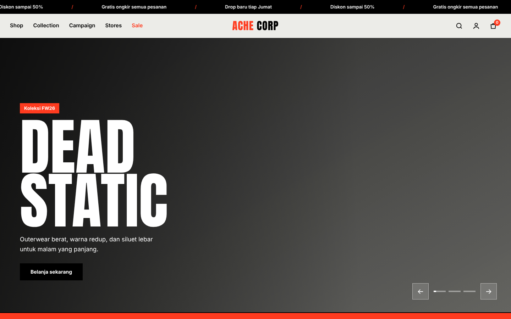
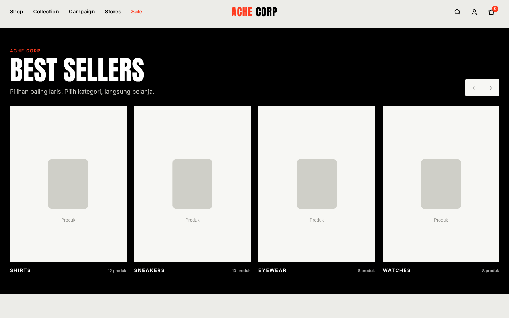
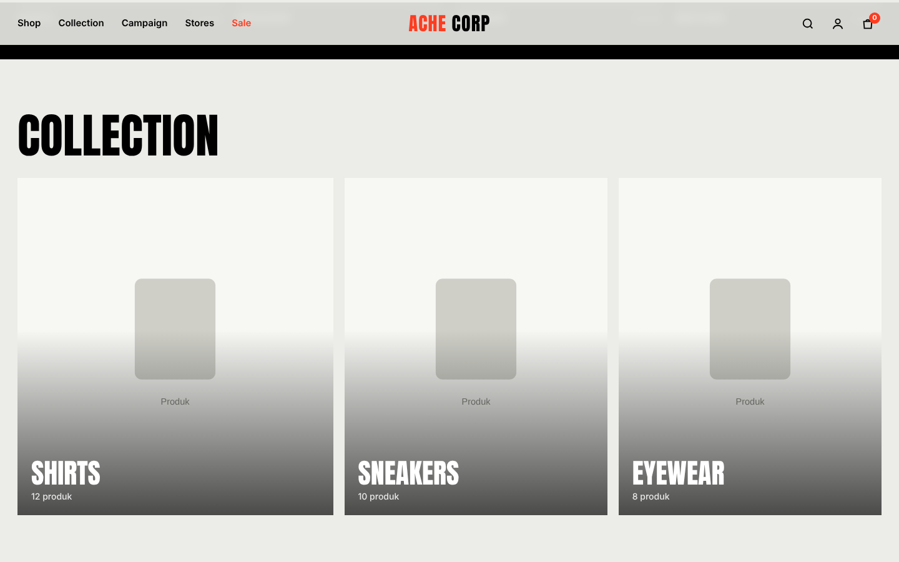
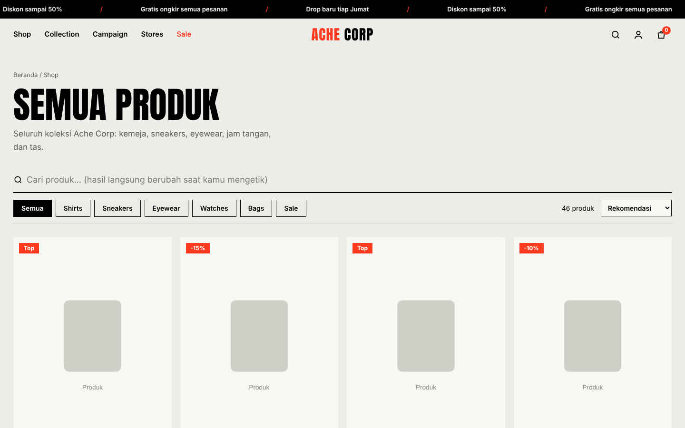
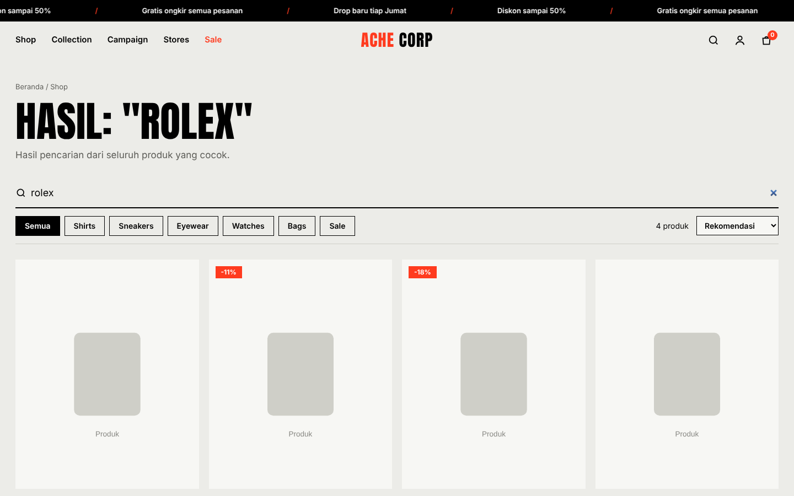
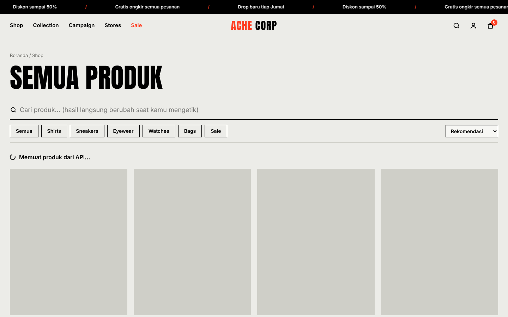
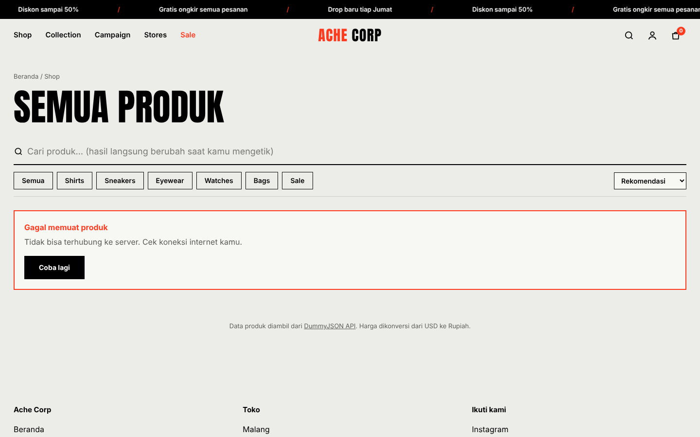
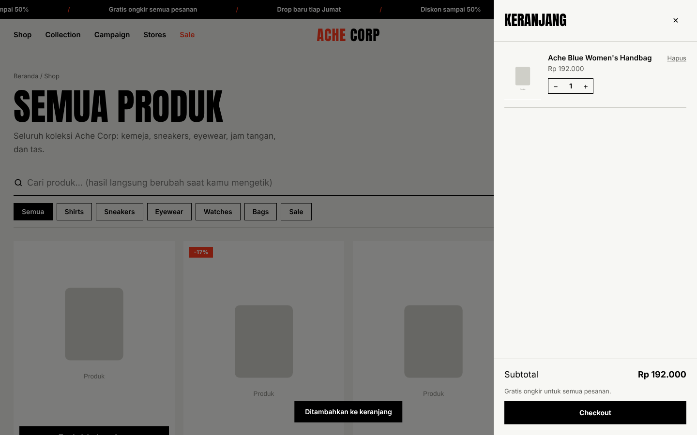
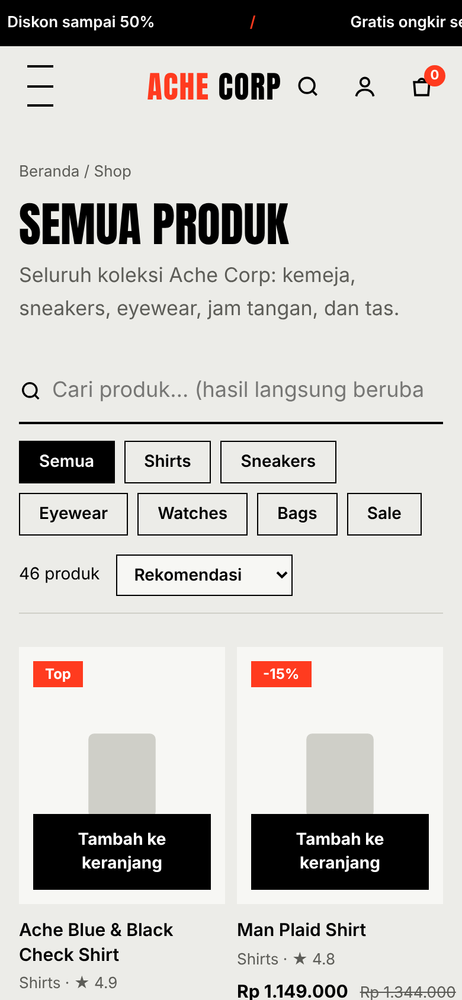
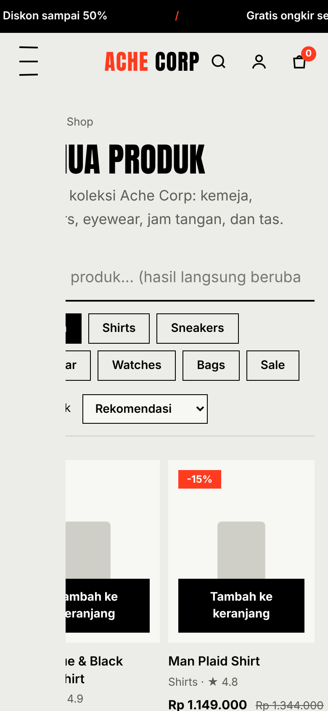

# Ache Corp — Streetwear Store

Website toko streetwear **Ache Corp** untuk tugas **Pemrograman Web (Modul 2: JavaScript, DOM Manipulation, Fetch API)** — Informatika, Universitas Muhammadiyah Malang.

Data produk diambil langsung dari public API **[DummyJSON](https://dummyjson.com/docs/products)** (`GET https://dummyjson.com/products`) memakai **Fetch API**, bukan data statis.

## Teknologi

| Bagian | Yang dipakai |
|---|---|
| HTML | HTML5 semantik, ARIA (`aria-live`, `aria-expanded`, `role="alert"`) |
| CSS | Tailwind CSS v4 (CLI), responsif mobile sampai desktop |
| JavaScript | Vanilla JS (ES6+), tanpa framework |
| API | DummyJSON (public REST API, JSON) |

## Fitur & kesesuaian dengan ketentuan tugas

| Ketentuan | Implementasi | File |
|---|---|---|
| Fetch API | `fetch()` + `async/await` + `response.json()` ke DummyJSON, dengan timeout (`AbortController`) | `src/api.js` |
| Render ke card | Card produk (halaman Shop), kartu kategori & tile collection (Beranda) | `src/shop.js`, `src/script.js` |
| Loading state | Skeleton card + teks "Memuat produk dari API…" saat data diambil | `src/shop.js`, `src/script.js` |
| Error message | Cek `response.ok`, `try/catch`, pesan ramah (jaringan putus / HTTP error / timeout) + tombol **Coba lagi** | `src/api.js`, `src/shop.js` |
| Search real-time | Input pencarian memfilter card langsung saat mengetik (event `input`) | `src/shop.js` |
| Filter | Tab kategori (Shirts, Sneakers, Eyewear, Watches, Bags, Sale) + urutkan harga/rating | `src/shop.js` |
| Event handling (≥ 2) | `click` (tab, tambah keranjang, muat lebih banyak, coba lagi, burger menu), `input` (search), `change` (sort), `submit` (login, register, newsletter), `keydown` (Enter/Escape) | semua file JS |
| Template literal | Semua markup card, tab, keranjang, dan hasil pencarian disusun dengan template literal | `src/shop.js`, `src/common.js`, `src/script.js` |
| Array method | `map`, `filter`, `find`, `reduce`, `some`, `includes`, `sort`, `slice` | semua file JS |
| Navbar toggle (codelab) | Burger menu untuk mobile | `src/common.js` |
| Validasi form (codelab) | Newsletter, login, dan register dengan pesan error | `src/script.js`, `src/common.js` |

Fitur tambahan: keranjang belanja (disimpan di `localStorage`), pencarian cepat di header, login/register demo, hero slider.

## Alur data

```
fetch(API) ─► response.ok? ─► response.json() ─► normalize() ─► filter / sort ─► render (template literal)
                  │ tidak
                  └─► throw Error ─► catch ─► tampilkan pesan error + tombol "Coba lagi"
```

Catatan data: DummyJSON memakai USD, harga dikonversi ke Rupiah (`USD_TO_IDR = 16000` di `src/api.js`). Hanya 5 kategori yang cocok untuk streetwear yang dipakai: `mens-shirts`, `mens-shoes`, `sunglasses`, `mens-watches`, `womens-bags`. Kategori **Sale** = diskon ≥ 10%.

## Cara menjalankan

Butuh koneksi internet (untuk memanggil API dan font).

```bash
git clone <url-repo-ini>
cd <nama-repo>
npm install
```

Buka `src/index.html` memakai Live Server (VS Code) atau:

```bash
npx serve .      # lalu buka http://localhost:3000/src/
```

Kalau mengubah class Tailwind di HTML/JS, build ulang CSS:

```bash
npm run build    # sekali jalan
npm run dev      # mode watch
```

## Struktur folder

```
.
├── src/
│   ├── index.html     # Beranda
│   ├── shop.html      # Halaman Shop (data dari API)
│   ├── api.js         # Fetch API + helper bersama
│   ├── common.js      # Header, keranjang, pencarian, login/register
│   ├── script.js      # Logika Beranda
│   ├── shop.js        # Logika halaman Shop
│   ├── input.css      # Sumber Tailwind
│   └── style.css      # Hasil build Tailwind
├── screenshots/       # Dokumentasi tampilan
├── package.json
└── README.md
```

## Dokumentasi tampilan

### Beranda




### Halaman Shop


**Search real-time**


**Loading state**


**Error message**


### Keranjang


### Tampilan mobile
 
